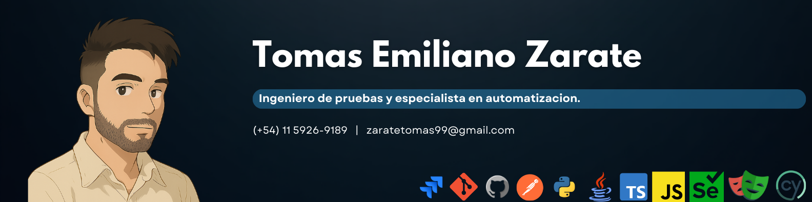

# Hola, soy Tomi

**QA Engineer · Buenos Aires, Argentina**

Automatización de pruebas de interfaz y de API.

## Sobre mí

Soy Tomas Emiliano Zarate, QA Engineer en Buenos Aires, Argentina. Me enfoco en la automatización de pruebas de interfaz y de API.

- **Interfaz:** Selenium con Python y pytest, y Selenium con Java.
- **API:** Python y RestAssured.
- **También:** TypeScript.

<!-- TODO(Tomas): formación. No está en el texto visible porque no figura en este README ni en la bio de GitHub.
Si querés sumarla, reemplazá este comentario por una línea. Ejemplo, solo si es correcto:
Estudiante de la Tecnicatura Universitaria en Programación a Distancia (TUPAD) en la UTN.
-->

## Stack

### Lenguajes

<picture>
  <source media="(prefers-color-scheme: dark)" srcset="https://skillicons.dev/icons?i=py,java,js,ts,html,mysql&perline=6&theme=dark">
  <source media="(prefers-color-scheme: light)" srcset="https://skillicons.dev/icons?i=py,java,js,ts,html,mysql&perline=6&theme=light">
  
</picture>

### Testing

<picture>
  <source media="(prefers-color-scheme: dark)" srcset="https://skillicons.dev/icons?i=selenium,cypress,postman&perline=3&theme=dark">
  <source media="(prefers-color-scheme: light)" srcset="https://skillicons.dev/icons?i=selenium,cypress,postman&perline=3&theme=light">
  
</picture>

 

### Herramientas

<picture>
  <source media="(prefers-color-scheme: dark)" srcset="https://skillicons.dev/icons?i=git,githubactions,jenkins,aws&perline=4&theme=dark">
  <source media="(prefers-color-scheme: light)" srcset="https://skillicons.dev/icons?i=git,githubactions,jenkins,aws&perline=4&theme=light">
  
</picture>

 

## Proyectos destacados

No hay repositorios de proyectos públicos para enlazar. El único repositorio público es este perfil. Los de automatización y el de TypeScript siguen en privado: cuando los hagas públicos, se pueden sumar acá.

<!-- TODO(Tomas): reemplazá este comentario por proyectos ya públicos. No enlaces repos privados: para el resto de la gente devuelven 404.

Plantilla:

### Nombre del proyecto

Qué automatiza o qué problema resuelve, en una o dos oraciones.

**Stack:**

[Ver repositorio](https://github.com/TOMASEZARATE/REEMPLAZAR)

Candidatos que hoy están en privado:
- automation-python-selenium-pytest — UI con Python, Selenium y pytest
- java-selenium — UI con Java y Selenium
- java-restAssured — API con RestAssured
- automationPythonAPI — API en Python
- service-connect — TypeScript (Vite, React, Tailwind, shadcn/ui). El README sigue siendo el template de Lovable.
-->

## Aprendiendo ahora

<!-- TODO(Tomas): reemplazá la línea de abajo por lo que estés aprendiendo. -->

*Por completar.*

## Contacto

- [LinkedIn](https://www.linkedin.com/in/tomasemilianozarate99/)
- [zaratetomas99@gmail.com](mailto:zaratetomas99@gmail.com)
- [(+54) 11 5926-9189](tel:+541159269189)

<!--
Estadísticas de GitHub: no están visibles a propósito.
Las tarjetas responden, pero solo cuentan actividad pública.
Hoy muestran 0 commits en el último año, 0 estrellas, "No languages data",
racha actual 0 y racha más larga de 1 día. Con los repos en privado, eso
desvirtúa el perfil.

Cuando haya actividad pública, se puede pegar esto:

<picture>
  <source media="(prefers-color-scheme: dark)" srcset="https://github-readme-stats.vercel.app/api?username=TOMASEZARATE&show_icons=true&hide_border=true&theme=github_dark">
  <source media="(prefers-color-scheme: light)" srcset="https://github-readme-stats.vercel.app/api?username=TOMASEZARATE&show_icons=true&hide_border=true&theme=default">
  
</picture>

<picture>
  <source media="(prefers-color-scheme: dark)" srcset="https://streak-stats.demolab.com/?user=TOMASEZARATE&theme=github-dark&hide_border=true">
  <source media="(prefers-color-scheme: light)" srcset="https://streak-stats.demolab.com/?user=TOMASEZARATE&theme=default&hide_border=true">
  
</picture>

Top languages de github-readme-stats hoy dice "No languages data". No lo sumes hasta que haya repos públicos con código.
-->
